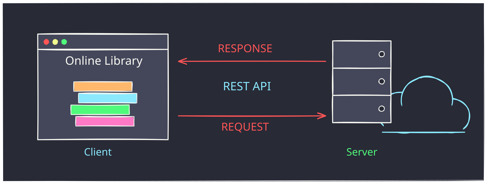
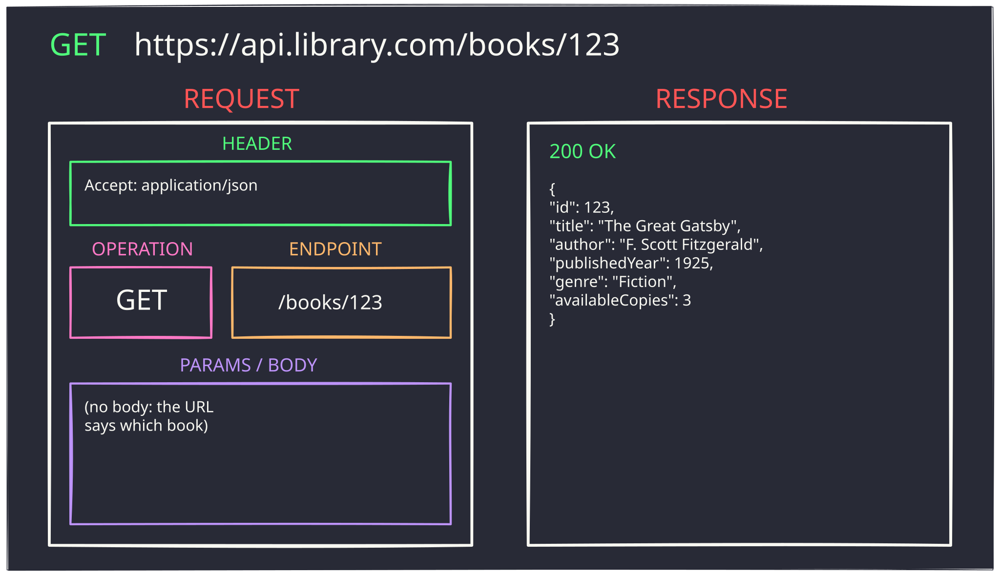
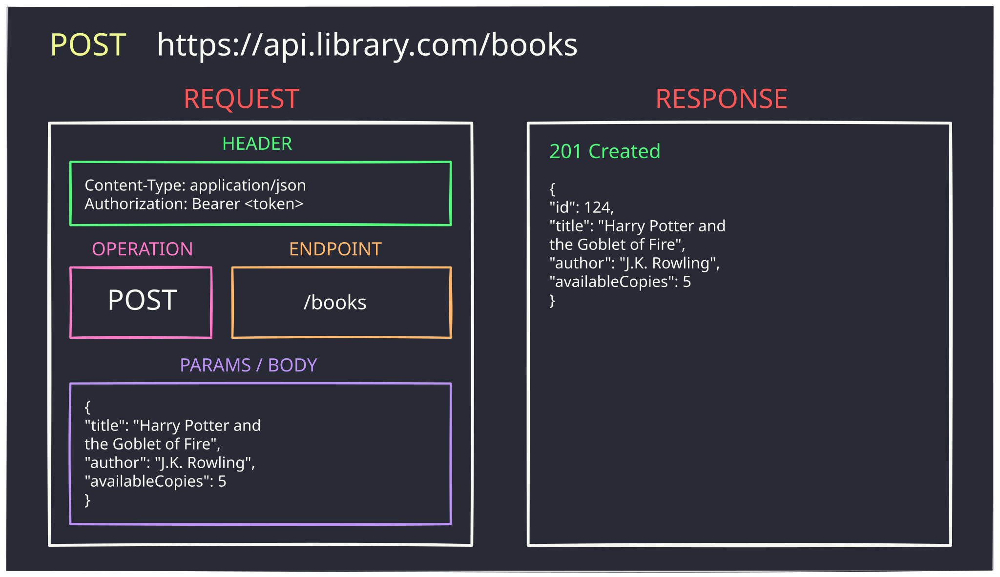
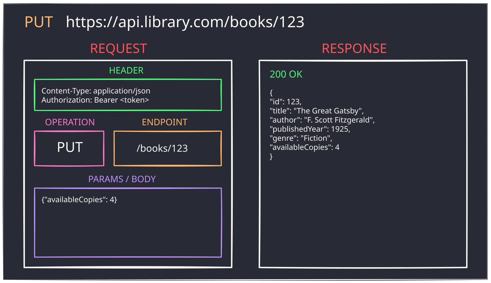
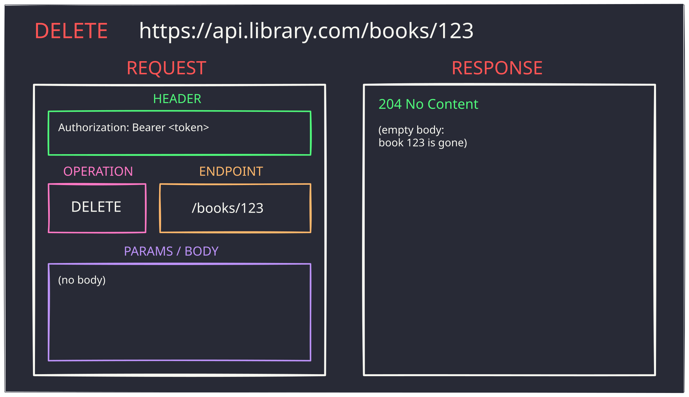

# <br><br><br>REST APIs for Beginners


<!--
⏱️ Slide Timing: 1 min

- Every app on your phone talks to a server somewhere — REST is the most common way it does that
- Promise: by the end, everyone can read a REST request and predict the response
- One running example for the whole session: an online library
-->

---

# What is an API?

- **API** = Application Programming Interface
- A set of rules for how one program asks another for something
- You only need to know **what to ask** and **what comes back**
  - not how the other program works inside
- A **web API** does this over the internet

<!--
⏱️ Slide Timing: 2 min

- Analogy: a restaurant menu
  - you order from the menu, the kitchen stays hidden
  - the waiter carries your order in and your food out
- Weather apps, maps, payments, chatbots — all call web APIs behind the scenes
-->

---

# What is a REST API?



- **REST**: shared rules for how a **client** asks and a **server** answers

> Diagram adapted from Rayhan's Tech Realm (2024) — see References

<!--
⏱️ Slide Timing: 3 min

- Focus on the two arrows: request goes out, response comes back — that loop is the whole idea
- The client always starts the conversation; the server only ever answers
- REST stands for REpresentational State Transfer
  - the name matters less than the rules it brings, coming up next
-->

---

# Watch: REST APIs Explained (in 5 minutes)

- Short walkthrough of REST using an online library: reading, adding, updating and deleting books
- [REST APIs Explained (in 5 minutes) — Rayhan's Tech Realm](https://www.youtube.com/watch?v=09od8C-Fd-A)

<!--
⏱️ Slide Timing: 6 min

- Play the full video (about 5 minutes), then pick up with the next slide
- Ask students to watch for the four boxes inside each request: header, operation, endpoint, body
- The rest of this deck slows down each step from the video
-->

---

# Resources and Endpoints

- A **resource** is a thing the API manages — here, **books**
- Each resource has an address, called an **endpoint**

| Endpoint | Means |
|---|---|
| `/books` | all books in the library |
| `/books/123` | the one book with id 123 |

- Endpoints are **nouns**; the action comes from the method (next slide)

<!--
⏱️ Slide Timing: 3 min

- Full address = base URL + endpoint
  - `https://api.library.com` + `/books/123`
- Common beginner mistake: verbs in the URL
  - `/getBook?id=123` or `/deleteBook/123` — REST avoids these
-->

---

# CRUD: Four Things You Can Do

| Action (CRUD) | HTTP method | Library example |
|---|---|---|
| **Create** | `POST` | Add a new book |
| **Read** | `GET` | Look up a book |
| **Update** | `PUT` | Change how many copies are available |
| **Delete** | `DELETE` | Remove a book |

- Same endpoint + different method = different action

<!--
⏱️ Slide Timing: 3 min

- CRUD covers almost everything apps do with data — think of any app and map its buttons to these four
- `/books/123` with GET reads it, with PUT updates it, with DELETE removes it
❓ Ask: "Which method would a 'Like' button on a social post most likely use?"
-->

---

# Inside a Request

- **Header** — extra details: data format, who you are (API key)
- **Operation** — the method: `GET`, `POST`, `PUT`, `DELETE`
- **Endpoint** — which resource: `/books/123`
- **Params / body** — data you send, usually as **JSON**

The **response** comes back with a **status code** and, usually, a **JSON body**

<!--
⏱️ Slide Timing: 3 min

- These four boxes appear in every diagram that follows — students should look for them each time
- JSON is just labelled data in curly braces: `"title": "The Great Gatsby"`
- Status code is the server's one-line verdict: did it work or not
-->

---

# Read a Book — GET



> Diagram adapted from Rayhan's Tech Realm (2024) — see References

<!--
⏱️ Slide Timing: 2 min

- GET only reads; nothing on the server changes
- No body needed — the endpoint already says which book
- `200 OK` means success; the JSON body is the book itself
-->

---

# Add a Book — POST



> Diagram adapted from Rayhan's Tech Realm (2024) — see References

<!--
⏱️ Slide Timing: 3 min

- POST goes to `/books`, not `/books/124` — the server picks the new id
- The body carries the new book as JSON; `Content-Type` tells the server it is JSON
- `201 Created` and the response includes the new `"id": 124`
-->

---

# Update a Book — PUT



> Diagram adapted from Rayhan's Tech Realm (2024) — see References

<!--
⏱️ Slide Timing: 3 min

- Someone borrowed a copy: available copies drop from 5 to 4
- Endpoint names the book; body says what to change
- Strictly, PUT replaces the whole record and PATCH changes part of it
  - many APIs blur this; check the API's docs
-->

---

# Remove a Book — DELETE



> Diagram adapted from Rayhan's Tech Realm (2024) — see References

<!--
⏱️ Slide Timing: 2 min

- The endpoint alone is enough; no body
- `204 No Content` — success, nothing to send back
- Most APIs require an API key for anything that changes data: note the `Authorization` header
-->

---

# Status Codes: Did It Work?

| Code | Meaning | Library example |
|---|---|---|
| `200 OK` | Success | Book found |
| `201 Created` | New resource made | Book added |
| `204 No Content` | Success, empty reply | Book deleted |
| `400 Bad Request` | Your data was wrong | Missing title |
| `401 Unauthorized` | No valid API key | Token missing |
| `404 Not Found` | No such resource | `/books/9999` |
| `500 Server Error` | Server broke | Bug on their side |

> Rule of thumb: **2xx = worked, 4xx = your mistake, 5xx = their mistake**

<!--
⏱️ Slide Timing: 3 min

- Everyone already knows 404 from broken web links — same code, same meaning
- When debugging, read the status code first, then the response body for the error message
-->

---

# Try It: Call a Real REST API in Python

```python
import requests

url = "https://jsonplaceholder.typicode.com/posts/1"

r = requests.get(url)                          # Read
print(r.status_code, r.json()["title"])

r = requests.put(url, json={"title": "Hi"})    # Update
print(r.status_code, r.json())
```

- **JSONPlaceholder** is a free practice API: no key, nothing really changes
- Swap `get`/`put` for `post`/`delete` to try the other two

<!--
⏱️ Slide Timing: 4 min

- Live-run this if possible; install with `uv add requests`
- Map each line back to the diagrams: method = `requests.put`, endpoint = the URL, body = `json=`
- `json=` also sets the `Content-Type` header for you
-->

---

# References and Credits

| Topic | Source |
|-------|--------|
| **Diagrams and library example (credit)** | Rayhan's Tech Realm. (2024). [*REST APIs Explained (in 5 minutes)*](https://www.youtube.com/watch?v=09od8C-Fd-A). YouTube. Diagrams in this deck are redrawn and adapted from this video. |
| **REST architectural style** | Fielding, R. (2000). [*Architectural Styles and the Design of Network-based Software Architectures*](https://www.ics.uci.edu/~fielding/pubs/dissertation/top.htm) (Doctoral dissertation, Chapter 5). University of California, Irvine. |
| **HTTP methods** | Mozilla. (2026). [HTTP request methods — MDN Web Docs](https://developer.mozilla.org/en-US/docs/Web/HTTP/Methods). |
| **HTTP status codes** | Mozilla. (2026). [HTTP response status codes — MDN Web Docs](https://developer.mozilla.org/en-US/docs/Web/HTTP/Status). |
| **Practice API** | typicode. (2026). [JSONPlaceholder — Free fake API for testing](https://jsonplaceholder.typicode.com/). |
| **`requests` library** | Reitz, K. (2026). [Requests: HTTP for Humans](https://requests.readthedocs.io/). |

<!--
⏱️ Slide Timing: 1 min

- Bookmark first: JSONPlaceholder for safe practice, MDN status codes for looking up any code you meet
- Credit to Rayhan's Tech Realm for the library example and diagram style used throughout
-->

---

# <br><br>Recap

- A **REST API** lets a client ask a server for **resources** by URL
- **Endpoints** are nouns; **methods** are verbs: `GET`, `POST`, `PUT`, `DELETE`
- Each request has a **header**, **operation**, **endpoint** and **body**
- Each response has a **status code** and usually a **JSON body**

<!--
⏱️ Slide Timing: 2 min

- Practice: pick any endpoint on JSONPlaceholder and predict the status code before you send the request
- Next step for curious students: HTTP itself (headers, URLs, raw messages) — REST sits on top of it
-->
