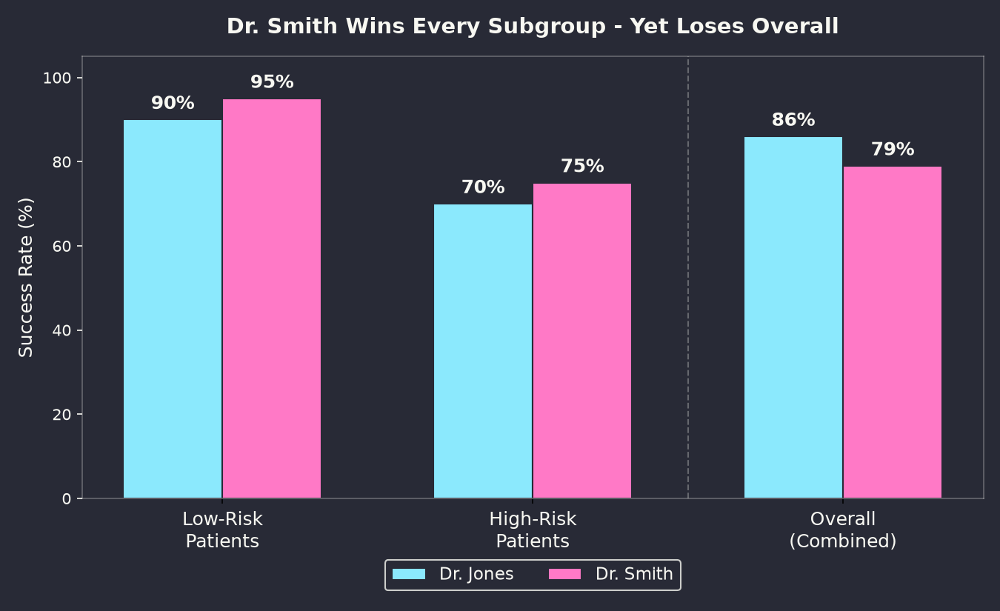
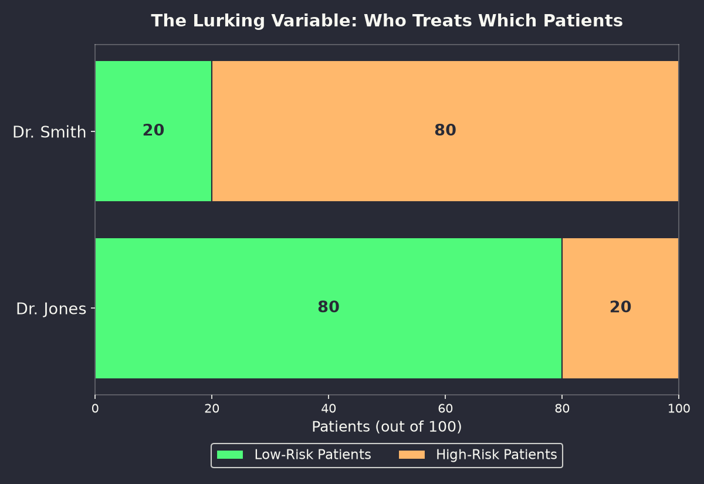
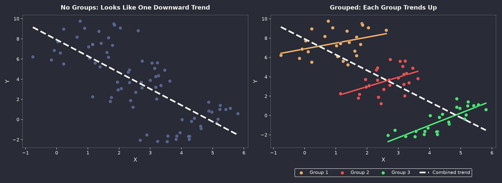

#     Simpson's Paradox

<!--
⏱️ Slide Timing: 1 min

- Welcome and frame the session: a data paradox that can quietly flip life-or-death decisions
- Promise: by the end, everyone will know to ask "what's hiding inside this average?"
- Bridge: open with a scenario that feels like an easy, obvious choice
-->

---

# The Setup: Choosing a Surgeon
- Imagine you need surgery and compare two doctors' track records:
   - **Dr. Jones:** 86% overall success rate
   - **Dr. Smith:** 79% overall success rate
- The numbers seem to make the choice for you

> **Question:** Is picking the doctor with the higher success rate always the rational choice?

<!--
⏱️ Slide Timing: 2 min

- Anchor the audience in a relatable, high-stakes decision — nobody picks a surgeon casually
- 86% vs 79% looks like a 7-point gap, which feels decisive
- Hold the blockquote question — the next slides will overturn the obvious answer
❓ Ask: "Based on these two numbers alone, who would you pick?"
-->

---

# Watch: Simpson's Paradox Explained

- [Simpson's Paradox: Why More Data Can Trick You](https://www.youtube.com/watch?v=vdaNwjlAq9M)
    - Source of the surgeon example and worked math in this deck
- [How Statistics Can Be Misleading](https://www.ted.com/talks/mark_liddell_how_statistics_can_be_misleading) — TED-Ed, Mark Liddell (2016)
    - 4 min; adds a smoking study and Florida death penalty cases
    - Ends on the point most explainers skip: the overall number is sometimes the right one

<!--
⏱️ Slide Timing: 1 min

- Good slide to leave on screen for anyone who wants to rewatch the walkthrough after the session
- The TED-Ed video is the shorter pre-read; its hospital example mirrors the surgeon story here
- Its closing point sets up the "Split or Combine?" slide near the end of this deck
-->

---

# Digging Deeper: Split by Patient Risk
- Ask the hospital for outcomes broken down by patient type
- **High-risk patients:**
   - Dr. Smith: **75%** success
   - Dr. Jones: **70%** success
- **Low-risk patients:**
   - Dr. Smith: **95%** success
   - Dr. Jones: **90%** success
- Dr. Smith wins **both** subgroups — yet loses overall

<!--
⏱️ Slide Timing: 3 min

- The reveal: Smith is better with the hard cases AND the easy cases
- This is the moment that should feel logically impossible — flag it explicitly
- Let the contradiction sit for a beat before explaining it on the next slide
-->

---

# The Numbers, Visualized

<!--
⏱️ Slide Timing: 3 min

- Same data as the last slide, now side by side — the pink bars (Smith) beat the blue bars (Jones) in both subgroups
- Then the rightmost pair flips: Jones's overall bar is taller than Smith's
- This single chart is the entire paradox in one image — everything after explains why it happens
-->

---

# How Is This Possible? The Caseload Mix

<!--
⏱️ Slide Timing: 4 min

- Dr. Smith is a specialist — 80 of her last 100 patients were high-risk cases
- Dr. Jones handles mostly routine surgery — 80 of his last 100 patients were low-risk
- The two doctors aren't being compared on the same mix of cases at all
-->

---

# Doing the Math: Weighted Averages

**Dr. Smith (20 low-risk, 80 high-risk)**
- Low-risk: 20 × 95% = **19** survivors
- High-risk: 80 × 75% = **60** survivors
- Total: 79 / 100 = **79%**

**Dr. Jones (80 low-risk, 20 high-risk)**
- Low-risk: 80 × 90% = **72** survivors
- High-risk: 20 × 70% = **14** survivors
- Total: 86 / 100 = **86%**

<!--
⏱️ Slide Timing: 4 min

- Walk through the arithmetic slowly — this is the "aha" slide where the paradox stops feeling magical
- Jones's overall number is pulled up by a large, easy caseload, not superior skill
- Smith's overall number is pulled down by a large, difficult caseload, not inferior skill
-->

---

# Naming the Phenomenon
- **Simpson's Paradox:** 
    - a trend appears in several groups of data 
        - but disappears or reverses when the groups are combined
- Variables can be **positively correlated** within every subgroup 
    - yet **negatively correlated** in aggregate
- The overall number told you to pick Jones
- The subgroup breakdown says Smith is the better choice, 
    - **for either kind of patient**

<!--
⏱️ Slide Timing: 3 min

- Formal definition, now that the audience has already felt the paradox firsthand
- Emphasize: this isn't a rare edge case — it's a structural risk in any aggregated comparison
- The named phenomenon dates to statistician Edward Simpson's 1951 paper, though the effect was noted earlier by others including Karl Pearson
-->

---

# Trend Reversal, Visualized

- **Left:** no group labels — looks like one clean downward trend
- **Right:** same data, colored by group — each group actually trends **upward**
- No single point moved — only whether the grouping was visible

<!--
⏱️ Slide Timing: 3 min

- This is the general shape of Simpson's Paradox beyond the surgeon example — it applies to any X-Y relationship, not just success rates
- Left panel is what a naive analysis sees; right panel is what stratifying by group reveals — same data, opposite conclusion
- The mechanism is the same as the surgeon case: groups differ in their typical X position, and that positioning — not the true within-group relationship — dominates the aggregate
-->

---

# The Lurking Variable
- A **lurking (confounding) variable** is a hidden factor 
    - that changes what the data appears to say
- In this example: 
    - it is the **proportion of high-risk vs. low-risk patients** each surgeon treats
    - It's correlated with:
        - The **outcome** (high-risk patients survive less often, regardless of surgeon)
        - The **group** being compared (Smith sees far more high-risk cases)
    - Ignore it, and the aggregate comparison is comparing apples to oranges

<!--
⏱️ Slide Timing: 3 min

- This slide is the conceptual core — everything else in the deck is an application of this one idea
- A lurking variable doesn't have to be exotic — patient mix, timing, sample size, or geography are common culprits
- Rule of thumb: whenever you compare rates across groups, ask what else differs between those groups
-->

---

# Real-World Case: Hospital Rankings
- Major referral centers and trauma hospitals 
    - often look **worse** on raw survival-rate rankings
- Reason: 
    - they take the sickest, most complex patients that smaller hospitals decline to treat
- Once outcomes are **risk-adjusted** for patient severity, 
    - top referral centers often move up substantially
- Raw league tables can punish the hospitals doing the hardest, most valuable work
> Source: Krumholz et al. (2006), risk-standardized mortality methodology — see References

<!--
⏱️ Slide Timing: 3 min

- Direct real-world echo of the surgeon example, now at institutional scale
- This is why healthcare quality metrics increasingly report "risk-adjusted mortality," not raw mortality
- Ties back to policy: a naive public ranking could steer patients away from the centers best equipped to save them
-->

---

# Real-World Case: Kidney Stone Treatments (1986)

| Success rate | Small stones | Large stones | Overall |
|---|---|---|---|
| Open surgery (older) | **93%** (81/87) | **73%** (192/263) | 78% (273/350) |
| PCNL (newer, less invasive) | 87% (234/270) | 69% (55/80) | **83%** (289/350) |

- The newer treatment looks **better overall** — but is **worse for both** stone sizes
- Cause: doctors gave the newer treatment mostly **small, easier** stones
- This was an **observational** comparison, not a randomized trial
> Source: Charig et al. (1986), British Medical Journal — see References

<!--
⏱️ Slide Timing: 3 min

- Same structure as the surgeon example, with real data: the lurking variable is stone size
- Large stones are harder to treat AND were steered toward open surgery — so open surgery's overall rate is dragged down by its harder caseload
- Randomization is the standard defense: if a coin decides who gets which treatment, stone size can't line up with treatment choice
- Observational data — patient records, product analytics, most dashboards — has no such protection
❓ Ask: "Where in your own data does someone choose which group a case lands in?"
-->

---

# Real-World Case: UC Berkeley Admissions (1973)
- Berkeley's graduate admissions showed an aggregate gap: 
    - **44%** of male applicants admitted vs. **35%** of female applicants
- This looked like evidence of bias against women applicants
- Broken down **by department**, 
    - most departments showed **no bias** — some even favored women slightly
- Explanation: 
    - women applied in greater numbers to more competitive departments 
        - with **lower overall admit rates**
> Source: Bickel, Hammel & O'Connell (1975), Science — see References

<!--
⏱️ Slide Timing: 4 min

- One of the most famous real applications of Simpson's Paradox, published by Bickel, Hammel & O'Connell in Science (1975)
- The lurking variable here is choice of department, not applicant sex — competitive departments admit fewer applicants of any gender
- Important nuance to state clearly: this doesn't prove there was zero bias anywhere in the system, just that the aggregate number alone was misleading as evidence
❓ Ask: "If you only saw the aggregate 44% vs 35% figures, what would you have concluded?"
-->

---

# Real-World Cases: Age as the Lurking Variable

**Smoking and survival (UK)**
- 20-year follow-up of 1,314 women in Whickham
- Overall: **24%** of smokers died vs **31%** of non-smokers
- The non-smokers were **older** on average
- Within most age groups, smokers died at the **higher** rate

**COVID-19 case fatality (2020)**
- Italy's overall case fatality rate was **higher** than China's
- Yet Italy's rate was **lower in every age group**
- Italy's confirmed cases were much **older**
- Same mechanism: a different mix, not a different risk

> Sources: Appleton, French & Vanderpump (1996); von Kügelgen, Gresele & Schölkopf (2021) — see References

<!--
⏱️ Slide Timing: 3 min

- Age is the most common lurking variable in practice: it drives outcomes and it differs between almost any two populations you might compare
- Smoking: the smokers in the sample were younger, so fewer of them died in 20 years — the aggregate made smoking look protective
- COVID: early cross-country comparisons of fatality rates were largely comparisons of age structure and testing
- The smoking case also appears in the TED-Ed video on the Watch slide
-->

---

# Aggregates Can Deceive
- An overall rate is a **weighted average** of subgroup rates, weighted by group size
- A group with a **large, easy** subset can post a high overall number without being the best performer
- A group with a **large, hard** subset can post a low overall number despite being the best performer
- This isn't rare — it shows up in medicine, admissions, sports, sales, and A/B tests
- **Golden Rule:** an aggregate statistic is a starting question, not a final answer

<!--
⏱️ Slide Timing: 2 min

- Transition slide — moving from "here's the paradox" to "here's what to do about it"
- Reconnect explicitly to the surgeon math slide: the weights differed, so the comparison was not apples-to-apples
- A/B tests: if traffic splits shift between segments mid-test (e.g. mobile vs desktop), the blended conversion rate can reverse the per-segment result
-->

---

# Look for Subgroups — Carefully
- Before trusting an aggregate comparison, ask:
   - What natural subgroups exist in this data?
   - Are they distributed **unevenly** across the things being compared?
   - Does splitting by subgroup change — or reverse — the conclusion?
- But splitting has its own risks:
   - Slice the data enough ways and **some split will reverse almost any result**
   - Small subgroups give **noisy** rates
- Choose splits for a reason **before** looking at the results

<!--
⏱️ Slide Timing: 3 min

- Encourage a habit: whenever a metric compares two groups (doctors, campaigns, cohorts), ask what's unevenly distributed underneath it
- The counterweight: hunting through dozens of segments until one flips is its own way to mislead
- A split justified by how the data was produced (patient risk, stone size, age) is far more credible than one found by searching
-->

---

# Split or Combine? Ask What Causes What
- **Split** when the third variable affects **both** the group and the outcome
    - Patient risk → which surgeon *and* survival
    - Stone size → which treatment *and* success
- **Combine** when the third variable is **caused by** the thing being compared
    - A drug lowers blood pressure, and lower blood pressure aids recovery
    - Splitting by blood pressure hides part of the drug's real effect
- The same numbers can call for either answer
    - the data alone can't tell you which — **how the data was produced** does
> Source: Pearl (2014), Understanding Simpson's Paradox — see References

<!--
⏱️ Slide Timing: 4 min

- This slide stops the audience over-learning "always stratify" — the subgroup view is not automatically the true one
- Confounder (split): a common cause of both the grouping and the outcome
- Mediator (combine): a step on the path from the thing being compared to the outcome — conditioning on it removes part of the effect you want to measure
- This is the same conclusion the TED-Ed video ends on: sometimes the overall number gives the more accurate picture
❓ Ask: "In the surgeon example, could the surgeon have caused the patient's risk level? Why does that matter?"
-->

---

# Before You Present a Comparison
1. List plausible lurking variables — and **how** each relates to the groups and the outcome
2. Compute both aggregate and subgroup rates; check whether the subgroup **weights** differ
3. Investigate any reversal — don't dismiss it as a data error
4. Decide split vs combine from **what causes what**, not from which answer you prefer
5. Report risk-adjusted or stratified metrics alongside raw ones
6. Never rank people, teams, or hospitals on raw aggregate rates alone

<!--
⏱️ Slide Timing: 2 min

- Workflow version of everything covered — a checklist to run before presenting or signing off on any comparative metric
- Every item here is a check the surgeon example, by construction, would fail
-->

---

# Key Takeaway

- The aggregate number is never the whole story
- Always ask what's hiding underneath the average: 
    - a lurking variable, 
    - an uneven mix, 
    - a hidden group
> Sometimes the better choice looks worse on paper

<!--
⏱️ Slide Timing: 1 min

- Closing summary before references — the three lines here compress the entire deck
- If nothing else survives from this session, this slide should
-->

---

# References

| Topic | Source |
|-------|--------|
| **Simpson (1951)** | Simpson, E. H. (1951). [The Interpretation of Interaction in Contingency Tables](https://www.jstor.org/stable/2984065). *Journal of the Royal Statistical Society: Series B*, 13(2), 238–241. |
| **Bickel, Hammel & O'Connell (1975)** | Bickel, P. J., Hammel, E. A., & O'Connell, J. W. (1975). [Sex Bias in Graduate Admissions: Data from Berkeley](https://www.science.org/doi/10.1126/science.187.4175.398). *Science*, 187(4175), 398–404. |
| **Charig et al. (1986)** | Charig, C. R., Webb, D. R., Payne, S. R., & Wickham, J. E. A. (1986). [Comparison of Treatment of Renal Calculi by Open Surgery, Percutaneous Nephrolithotomy, and Extracorporeal Shockwave Lithotripsy](https://www.bmj.com/content/292/6524/879). *British Medical Journal*, 292(6524), 879–882. |
| **Krumholz et al. (2006)** | Krumholz, H. M., Wang, Y., Mattera, J. A., et al. (2006). [An Administrative Claims Model Suitable for Profiling Hospital Performance Based on 30-Day Mortality Rates Among Patients With Heart Failure](https://www.ahajournals.org/doi/10.1161/CIRCULATIONAHA.105.611194). *Circulation*, 113(13), 1693–1701. |
| **Appleton, French & Vanderpump (1996)** | Appleton, D. R., French, J. M., & Vanderpump, M. P. J. (1996). [Ignoring a Covariate: An Example of Simpson's Paradox](https://www.tandfonline.com/doi/abs/10.1080/00031305.1996.10473549). *The American Statistician*, 50(4), 340–341. |
| **Pearl (2014)** | Pearl, J. (2014). [Understanding Simpson's Paradox](https://ftp.cs.ucla.edu/pub/stat_ser/r414.pdf). *The American Statistician*, 68(1), 8–13. |
| **von Kügelgen, Gresele & Schölkopf (2021)** | von Kügelgen, J., Gresele, L., & Schölkopf, B. (2021). [Simpson's Paradox in COVID-19 Case Fatality Rates: A Mediation Analysis of Age-Related Causal Effects](https://arxiv.org/abs/2005.07180). *IEEE Transactions on Artificial Intelligence*, 2(1), 18–27. |

<!--
⏱️ Slide Timing: 1 min

- Simpson (1951) is the formal statistical origin, though the pattern was observed earlier by Pearson and Yule
- Charig et al. (1986) is the classic kidney-stone treatment case, textbook example of Simpson's Paradox in a clinical trial
- Krumholz et al. (2006) underlies the risk-standardized mortality methodology CMS uses for hospital rankings
- Bickel, Hammel & O'Connell (1975) is the canonical UC Berkeley case study referenced earlier in the deck
- Pearl (2014) gives a modern causal-inference framing of why and when the paradox occurs — the basis of the "Split or Combine?" slide
- Appleton et al. (1996) is the Whickham smoking study; von Kügelgen et al. (2021) analyses the Italy vs China COVID-19 reversal
-->
