#     Dashboard & Visualization Design

<!--
⏱️ Slide Timing: 1 min

- Goal for today: simple rules of thumb to make reports look clean and read fast
  - no design background assumed
- Everything here applies to Power BI, but also Excel, Tableau, slides
- By the end: a checklist you can run on your own assignment report
-->

---

# Why Design Matters

- A dashboard is a **conversation**, not a data dump
- Readers decide in **~5 seconds** whether it is useful
- Good design = the reader finds the answer **without you in the room**
- Same data, better layout → faster, better decisions

> If the reader has to ask "what am I looking at?", the design failed

<!--
⏱️ Slide Timing: 2 min

- Most beginner reports have correct numbers but are hard to read
  - visuals scattered, every chart a different colour, no titles
- Design is not decoration — it is how you remove effort for the reader
- The 5-second test: show your page to a friend for 5 seconds, ask what the main message was
-->

---

# Start with Three Questions

- **Who** is reading?
  - Manager: big numbers, trends
  - Analyst: details, filters, tables
- **What** question must it answer?
  - e.g. "Are we on track against plan this quarter?"
- **What action** should they take after reading?

> Write the answer in one sentence before you drag in a single visual

<!--
⏱️ Slide Timing: 3 min

- Ask students to write their one-sentence purpose for their assignment report
- Everything later (placement, colour, chart type) follows from these answers
- If a visual does not help answer the question — remove it
-->

---

#    Layout Principles

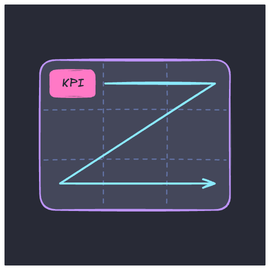

<!--
⏱️ Slide Timing: 0.5 min

- Six principles: placement, rule of thirds, balance, proximity, contrast, repetition
-->

---

# 1. Placement — Most Important Top-Left

- Eyes start at the **upper-left**
- Then scan left → right, top → down
- Put the **key message / KPIs** there
- Details go lower down
> Exception: right-to-left languages (Arabic/Hebrew)

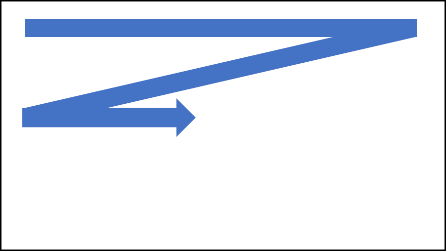

###### Image: Microsoft, [*Design the analytical report layout*](https://learn.microsoft.com/en-us/training/modules/power-bi-effective-reports/2-design-layout), Microsoft Learn

<!--
⏱️ Slide Timing: 2 min

- Same way we read a page of text — a "Z" scan
- Common mistake: slicers taking the whole top-left corner
  - the most valuable spot is spent on a filter, not an insight
- Bottom-right is the least-seen spot — good for footnotes, data source, refresh date
-->

---

# 2. Placement — Rule of Thirds

- Split the page into a **3 × 3 grid**
- Place key visuals on the **lines / intersections**

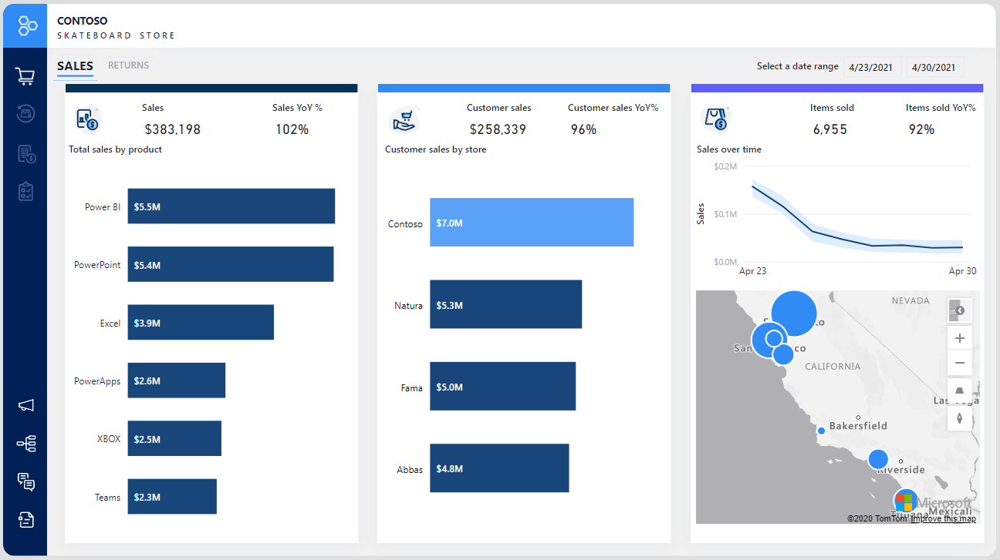

###### Image: Microsoft, [*Design the analytical report layout*](https://learn.microsoft.com/en-us/training/modules/power-bi-effective-reports/2-design-layout), Microsoft Learn

<!--
⏱️ Slide Timing: 2 min

- Borrowed from photography — intersections attract attention naturally
- Practical use: size visuals in thirds (1/3 + 2/3 width) instead of random widths
- Power BI: View → Gridlines helps you see the canvas grid
-->

---

# 3. Balance — Golden Ratio

- Avoid one side "heavy", the other empty
- Golden ratio ≈ **1 : 1.618**
  - e.g. narrow panel + wide chart
- Big visuals carry more "weight"
  - spread them evenly

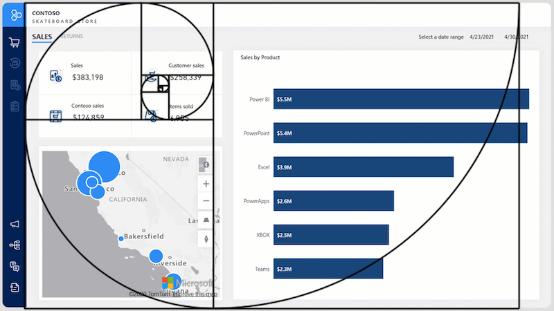

###### Image: Microsoft, [*Design the analytical report layout*](https://learn.microsoft.com/en-us/training/modules/power-bi-effective-reports/2-design-layout), Microsoft Learn

<!--
⏱️ Slide Timing: 2 min

- Don't measure precisely — use it as a sense check
- Example in picture: KPI cards + map on left (smaller), bar chart on right (larger)
- Quick check: squint at your page — does one area feel crowded?
-->

---

# 4. Proximity — Group Related Visuals

- Related visuals sit **near each other**
- Use **whitespace** to separate groups
- A shape / background box can frame a group

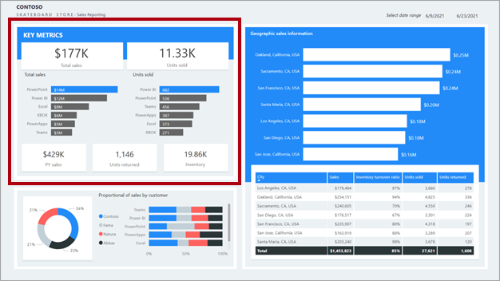

###### Image: Microsoft, [*Design the analytical report layout*](https://learn.microsoft.com/en-us/training/modules/power-bi-effective-reports/2-design-layout), Microsoft Learn

<!--
⏱️ Slide Timing: 2 min

- Readers assume things close together are related
  - e.g. Sales KPI next to the Sales trend chart, Cost KPI next to Cost chart
- Whitespace is free — beginners tend to fill every pixel
-->

---

# 5. Contrast — Make the Important Stand Out

- Use contrasting **colour / size** to highlight
  - one key number, one bar, actual vs. target
- If everything is highlighted, **nothing** is

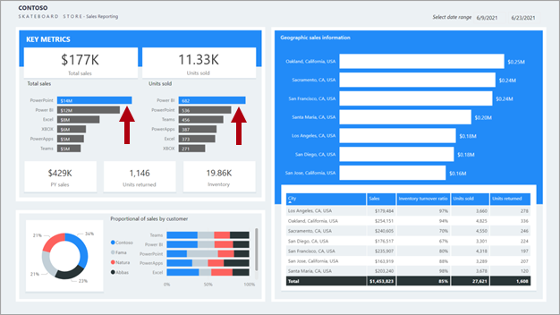

###### Image: Microsoft, [*Design the analytical report layout*](https://learn.microsoft.com/en-us/training/modules/power-bi-effective-reports/2-design-layout), Microsoft Learn

<!--
⏱️ Slide Timing: 2 min

- Example: grey bars for all products, one accent colour for the product you want to talk about
- Size contrast: the KPI value big, the label small
-->

---

# 6. Repetition — Be Consistent

- Same **fonts, colours, title style, borders** everywhere
- Same colour = same meaning across pages
- Ties the report together visually

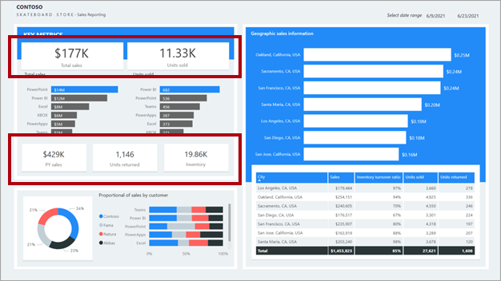

###### Image: Microsoft, [*Design the analytical report layout*](https://learn.microsoft.com/en-us/training/modules/power-bi-effective-reports/2-design-layout), Microsoft Learn

<!--
⏱️ Slide Timing: 2 min

- If "Online" is blue on page 1, it must be blue on page 3 as well
- Power BI tools: Format Painter (Home tab), and a report Theme (View → Themes)
- Consistency is the quickest way to look "professional"
-->

---

#    Dashboard Layout Ideas

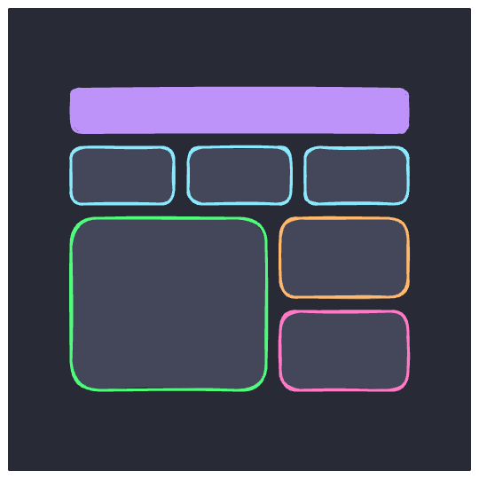

<!--
⏱️ Slide Timing: 0.5 min

- Don't start from a blank canvas — start from a proven template
-->

---

# Sample Layout — Top-Down Story

- **Header** — title, slicers, logo
- **KPI cards** — the headline numbers
- **High-level** — trends, summary charts
- **Detailed** — tables, breakdowns
> Overview first, details on demand

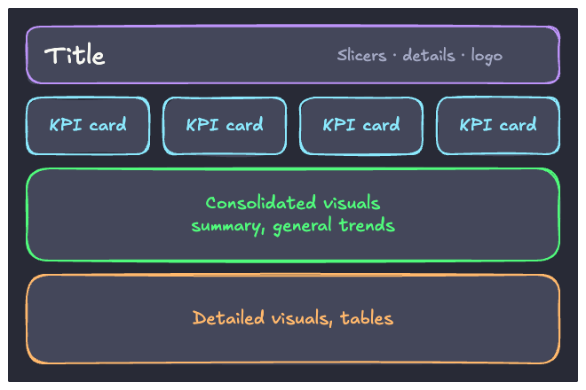

<!--
⏱️ Slide Timing: 2 min

- Mirrors how a manager reads: "How are we doing?" → "Why?" → "Which ones?"
- This one layout works for most assignments
- Very detailed tables can move to a drill-through page instead
-->

---

# Sample 2 × 2 Grid

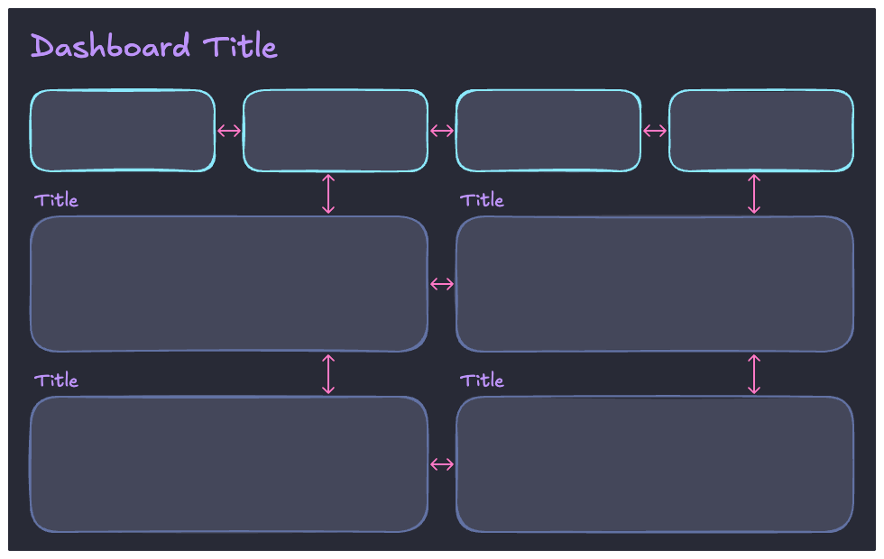

<!--
⏱️ Slide Timing: 1 min

- Four KPI cards on top, four equal visuals below
- Arrows: keep gaps the SAME size, both horizontally and vertically
- Each visual has its own short title
-->

---

# Sample 3 × 2 Grid

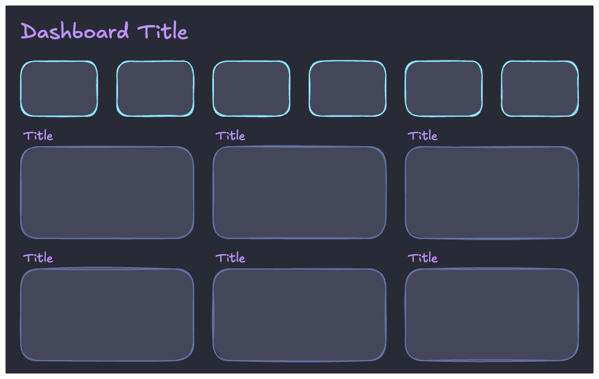

<!--
⏱️ Slide Timing: 1 min

- Six KPI cards, six visuals — denser, for analyst audiences
- Upper limit for one page — more than this becomes clutter
-->

---

# Modified Grid — Real Examples

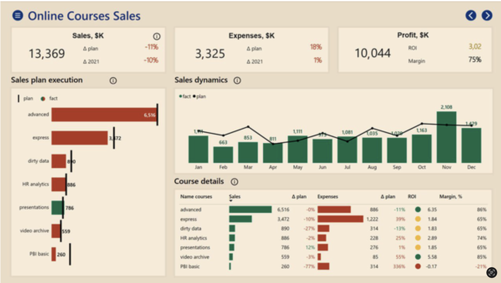

###### Image Source: Power BI Course Sample Dashboard / Analytics Mockup Template

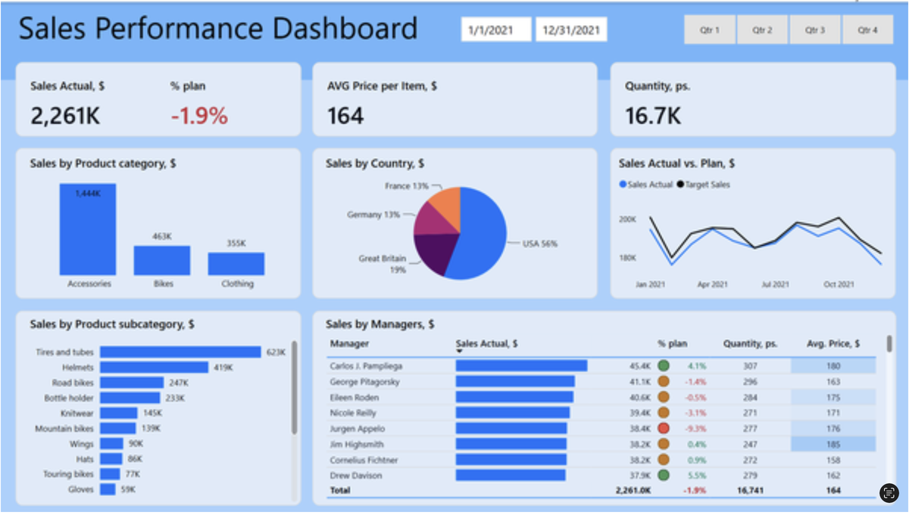

###### Image Source: Power BI Executive Sales Report Template (based on Microsoft AdventureWorks Sample Data)

- Start from a grid, then **merge cells** for bigger visuals

<!--
⏱️ Slide Timing: 3 min

- Left: tall bar chart on left spans two rows; trend + table share the right
- Right: KPI row, three charts, then a wide table across two columns
- Ask students: what do both have in common? (KPI row on top, equal gaps, titles on every visual, limited colours)
-->

---

#    Choosing the Right Visual

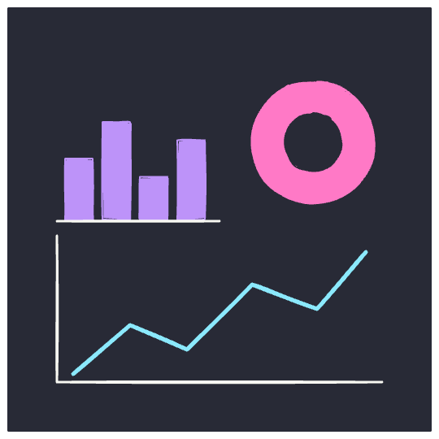

<!--
⏱️ Slide Timing: 0.5 min

- Layout gets attention; the right chart gets understanding
-->

---

# Match the Chart to the Question

| I want to show... | Use | Power BI visual |
|-------------------|-----|-----------------|
| **One key number** | Card / KPI | Card, KPI, Gauge (sparingly) |
| **Compare categories** | Bar / Column | Clustered bar / column |
| **Trend over time** | Line | Line, Area |
| **Part of a whole** (≤ 5 parts) | Stacked bar, Donut | 100% stacked bar, Donut |
| **Relationship** between 2 measures | Scatter | Scatter chart |
| **Exact values / detail** | Table | Table, Matrix |
| **Location** | Map | Map, Filled map |

<!--
⏱️ Slide Timing: 3 min

- Start from the question, not from the visual you like the look of
- Time always goes left → right on the x-axis
- Sort bar charts by value (largest first) unless categories have a natural order
-->

---

# Design Effective KPI Cards

- Big **value**, small **label**
- Add **context**: vs. target, vs. last year
- Colour only the **variance** (▲ green / ▼ red)
- Keep **3–5 cards**, same size, one row

###### Image Source: Power BI Course Sample Dashboard / Analytics Mockup Template

> "13,369" alone means nothing — "13,369 (−11% vs plan)" tells a story

<!--
⏱️ Slide Timing: 2 min

- Point at the example: Sales $K with Δ plan and Δ 2021, only the deltas are coloured
- Power BI: new Card visual supports reference labels; or the KPI visual (value + target + trend)
- Consistent number format across cards — all $K or all $M, not mixed
-->

---

# Common Chart Mistakes

- **Pie with many slices** → use a sorted bar chart
- **3D charts** → distort size; always use 2D
- **Bar axis not starting at 0** → exaggerates differences
- **Too many series** on one line chart (> 4–5) → spaghetti
- **Unsorted bars** → reader hunts for the biggest
- **Table** when a chart would show the pattern faster

<!--
⏱️ Slide Timing: 3 min

- Humans compare lengths far better than angles — that is why bars beat pies
- Line charts may start above 0 (focus on change); bar charts should not
- Too many series: split into small multiples, or highlight one and grey the rest
-->

---

#    Colour, Text & Clutter

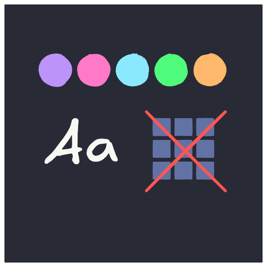

<!--
⏱️ Slide Timing: 0.5 min

- The finishing touches that separate an "ok" report from a clear one
-->

---

# Use Colour with Purpose

- Pick **one theme**, max ~**3–5 colours**
- **Grey** for context, **one accent** for the focus
- Keep meaning consistent
  - green = good / red = bad, same category = same colour
- Don't rely on colour alone (~1 in 12 men are colour-blind)
  - add labels, icons or ± signs
- Check **contrast**: text must be readable on its background

<!--
⏱️ Slide Timing: 3 min

- Power BI: View → Themes, pick one and stick with it; avoid the default rainbow when it adds no meaning
- Red/green together is the most common colour-blind problem — add ▲▼ or + / − signs
- Conditional formatting in tables is great, but limit to one or two columns
-->

---

# Titles, Labels & Text

- Every visual needs a **clear title**
  - Better: titles that state the **insight**
  - "Sales by Month" → "Sales peaked in November"
- Show **units**: $K, %, pcs
- Round numbers: **2.3M** not 2,261,437.58
- Data labels **or** axis — often not both
- Use at most **2 font sizes** for body text; title larger

<!--
⏱️ Slide Timing: 3 min

- Power BI: Format → Display units and Value decimal places
- Rename fields so titles read naturally (Sum of SalesAmt → Sales)
  - rename in the visual's field well, or in the model
- Accessibility: Power BI has alt text on each visual (Format → General → Alt text)
-->

---

# Declutter — Less is More

**Remove**
- Heavy gridlines & borders
- Background images & effects
- Duplicate legends / labels
- Visuals that don't answer the question

**Keep**
- Whitespace between groups
- Few visuals per page (**~5–7**)
- A legend only if needed
- One idea per visual

> Every element should earn its place on the page

<!--
⏱️ Slide Timing: 2 min

- "Data-ink ratio" (Edward Tufte): maximise ink spent on data, minimise decoration
- If a page needs more than ~7 visuals, split into another page or use drill-through
- Exercise: remove one thing from your report — does anyone miss it?
-->

---

# Power BI Tools That Help

| Need | Where in Power BI Desktop |
|------|---------------------------|
| Align & equal spacing | **Format** tab → Align / Distribute |
| Snap to a grid | **View** tab → Gridlines, Snap to grid |
| Exact size & position | Format pane → General → Properties |
| Consistent styling | **Home** tab → Format painter; **View** tab → Themes |
| Find / layer / hide visuals | **View** tab → Selection pane |
| Control cross-filtering | **Format** tab → Edit interactions |
| Phone-friendly view | **View** tab → Mobile layout |

<!--
⏱️ Slide Timing: 3 min

- Demo if time: select 3 cards → Format → Align top → Distribute horizontally
- Selection pane also sets the tab order for keyboard / screen reader users
- Edit interactions: stop a KPI card from being filtered by a chart click when it shouldn't be
-->

---

# Slicers & Interactivity

- Keep slicers **together** — top bar or left panel
- **≤ 3–4 slicers** per page; more → use the Filter pane
- Show what's filtered (e.g. selected date range)
- Use **tooltips** for extra detail instead of extra visuals
- Use **drill-through** pages for the deep detail

<!--
⏱️ Slide Timing: 2 min

- Interactivity lets one clean page replace many cluttered ones
- Same slicer on every page? Use Sync slicers (View → Sync slicers)
- Test: click every visual — does the cross-filtering make sense?
-->

---

# Navigation & Multi-Page Reports

- One page = **one topic** (Overview, Sales, Customers, ...)
- Same **header, slicers, nav buttons** in the same spot on every page
- Use a **page navigator** or buttons; meaningful page names
- Drill-through pages need a **Back** button
- **Hide** helper / tooltip pages before publishing
- Keep the default **16:9 canvas** (1280 × 720) unless you have a reason

<!--
⏱️ Slide Timing: 2 min

- Power BI: Insert → Buttons → Navigator → Page navigator builds the buttons automatically
- Drill-through pages get a Back button automatically when you add a drill-through field
- Right-click a page tab → Hide page
- Users get lost when the header jumps around between pages — repetition principle again
-->

---

# Before You Publish — Checklist

- ☐ Main message clear in **5 seconds**?
- ☐ KPIs in the **top-left / top row**?
- ☐ Related visuals **grouped**, gaps **equal**, edges **aligned**?
- ☐ Right **chart type**, sorted, axis from 0 for bars?
- ☐ **Titles, units**, rounded numbers?
- ☐ Limited, **consistent colours**; colour-blind safe?
- ☐ Slicers grouped, **interactions & navigation tested**?

<!--
⏱️ Slide Timing: 2 min

- Use this list on every assignment page before submitting
- Pair up: swap laptops and run the checklist on each other's report
-->

---

# Key Takeaway

- **Purpose first** — who, what question, what action
- **Layout** — top-left KPIs, overview → detail, grid & whitespace
- **Visuals** — pick the chart for the question, keep it simple
- **Style** — few colours, clear titles, consistent everywhere

> Make the reader's job easy

<!--
⏱️ Slide Timing: 1 min

- If they remember one thing: design for the reader, not for yourself
-->

---

# References

| Topic | Source |
|-------|--------|
| **Report design principles** | Microsoft. (2024). [*Design Power BI reports*](https://learn.microsoft.com/en-us/training/modules/power-bi-effective-reports/). Microsoft Learn. |
| **Layout images (slides 1–6)** | Microsoft. (2025). [*Design the analytical report layout*](https://learn.microsoft.com/en-us/training/modules/power-bi-effective-reports/2-design-layout). Microsoft Learn. Images used for educational purposes. |
| **Report design tips** | Microsoft. (2024). [*Tips for designing a great Power BI dashboard*](https://learn.microsoft.com/en-us/power-bi/create-reports/service-dashboards-design-tips). Microsoft Learn. |
| **Accessibility** | Microsoft. (2024). [*Design Power BI reports for accessibility*](https://learn.microsoft.com/en-us/power-bi/create-reports/desktop-accessibility-overview). Microsoft Learn. |
| **Visual types** | Microsoft. (2024). [*Visualization types in Power BI*](https://learn.microsoft.com/en-us/power-bi/visuals/power-bi-visualization-types-for-reports-and-q-and-a). Microsoft Learn. |
| **Example dashboards** | Dashboards generated via Microsoft Power BI using custom analytics templates and standard sample dataset schemas (Microsoft AdventureWorks). |
| **Data visualization** | Knaflic, C. N. (2015). *Storytelling with Data*. Wiley. |
| **Data-ink ratio** | Tufte, E. R. (2001). *The Visual Display of Quantitative Information* (2nd ed.). Graphics Press. |

<!--
⏱️ Slide Timing: 1 min

- Highest priority: the Microsoft Learn module — short, with exercises
- Storytelling with Data is the most beginner-friendly book on the topic
-->

---

# Thank You

- Questions?

<!--
⏱️ Slide Timing: 5 min

- Invite a student to share their report page; run the checklist live together
- Common questions to expect
  - "Can I use custom visuals?" — yes, but only if a built-in one can't do the job
  - "Dark or light background?" — either; consistency and contrast matter more
-->
