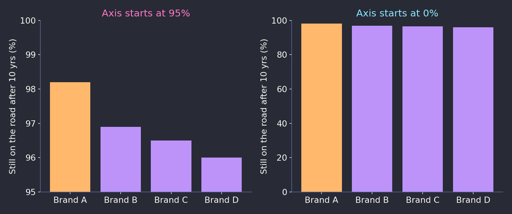
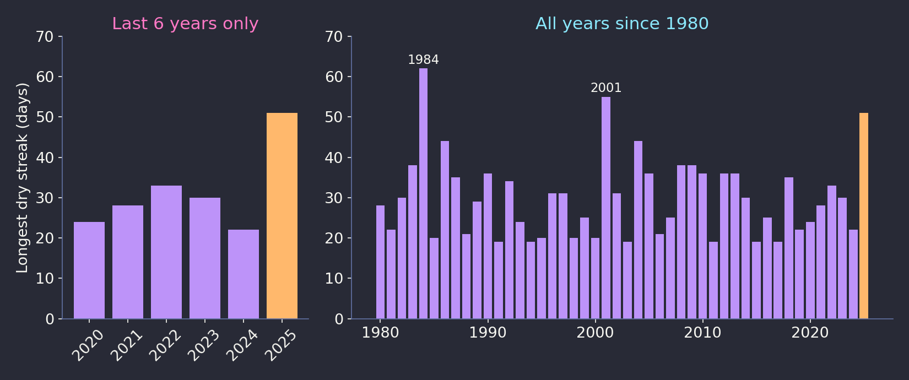
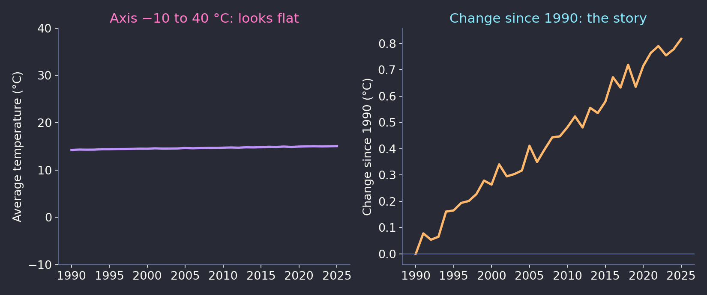

#     How to Spot a Misleading Graph

<!--
⏱️ Slide Timing: 0.5 min

- Short video first, then we unpack it
- Goal: a checklist you can run on any chart — in the news, at work, or in your own reports
-->

---

# Watch: How to Spot a Misleading Graph

<i class="fa-solid fa-circle-play"></i> [**Play on TED**](https://www.ted.com/talks/lea_gaslowitz_how_to_spot_a_misleading_graph)

TED-Ed lesson by **Lea Gaslowitz** · directed by Mark Phillips · narrated by Pen-Pen Chen (2017)

Lesson page with quiz & discussion: [ed.ted.com/lessons/how-to-spot-a-misleading-graph-lea-gaslowitz](https://ed.ted.com/lessons/how-to-spot-a-misleading-graph-lea-gaslowitz)

> While you watch: note every trick the video shows. Which ones have you seen at work?

<!--
⏱️ Slide Timing: 5 min (video ~4–5 min)

- Click "Play on TED" — opens in the browser; go full screen
- Ask the class to jot down each trick as it appears
- After the video: quick round — "which trick surprised you most?"
-->

---

# Why It Matters

- Graphs help us grasp complex data **at a glance**
- That same speed makes them easy to **misuse**
- Misleading graphs can be **deliberate** — or simply **careless**
- Either way, the reader walks away with the wrong conclusion

> A chart is an argument. Check it before you accept it.

<!--
⏱️ Slide Timing: 2 min

- We trust pictures more than tables — our eyes do the maths for us, and that is the weakness
- The video's point: the problem is not graphs, it is how they are built
- Most misleading charts you meet at work are accidents, not lies — but the damage is the same
-->

---

# 1. Check the Y-Axis — Where Does It Start?

###### Illustrative data. Same four numbers, two different y-axis ranges.

- A **truncated axis** turns a ~2-point gap into a "huge" lead
- Bar charts are worst: we read **bar length as the value**

<!--
⏱️ Slide Timing: 3 min

- The video's example: a truck ad where the axis started near 95%, so one brand looked far ahead
- Ask: on the left, how much more reliable does Brand A look? (2–3×). Real gap: ~2 points
- Rule: bar and column charts start at zero. Line charts may zoom in — but say so clearly
-->

---

# 1. Check the X-Axis Too

- Are the intervals **evenly spaced**?
  - e.g. 2000, 2005, 2010, **2023** — a gap hidden in plain sight
- Is any period **skipped** or **squeezed**?
- Is the axis **labelled**, with **units**?
- Is any axis **missing a scale** altogether?

> No scale = no way to judge size. Treat it as decoration, not evidence.

<!--
⏱️ Slide Timing: 2 min

- The video lists both axes: y-axis not starting at zero, x-axis skipping intervals, scales left out
- Uneven x-axis makes growth look smoother or sharper than it was
- Quick habit: read the axis labels before you look at the shape
-->

---

# 2. Does the Measure Make Sense?

- Ask: **what exactly is being shown**, and is it the right measure?
  - Video example: a dollar cost shown as **how much space the cash would fill** — vivid, but not useful
- **3D and picture graphs** look good but **distort** size
  - Doubling an icon's height also doubles its width → looks **4×** bigger
- **Mixed data**: two different measures on one chart with **two y-axes**
  - Each axis can be stretched to make the lines "agree"

<!--
⏱️ Slide Timing: 3 min

- An eye-catching unit (stacks of cash, football fields) feels meaningful but rarely helps a decision
- 3D pies: slices at the front look bigger than the same slice at the back
- Dual-axis charts: you can make almost any two lines cross by choosing the axis ranges
-->

---

# 3. Cherry-Picking — What Was Left Out?

###### Illustrative data. Left: a short window makes 2025 look like a record. Right: it isn't.

<!--
⏱️ Slide Timing: 3 min

- The video's example: a weather chart that compared a dry spell only with the last few years, so it looked like near-record — older years had a longer streak
- That one was probably careless, not dishonest — someone just picked a short date range
- Ask of every time chart: why does it start *here*? What happens if I go further back?
-->

---

# 4. Context — Is the Scale Right for the Story?

###### Illustrative data. A scale that is too wide can hide a change that matters.

- Zooming **out** can mislead as much as zooming **in**
- Look for **ignored variables**: population, inflation, season

<!--
⏱️ Slide Timing: 3 min

- The flip side of the truncated axis: a huge range flattens a small change that is still important
- Here, under one degree looks like nothing on the left — but for climate it is a big shift
- Ignored variables: "crime went up" — did population go up too? Show per-capita
- So "always start at zero" is not the whole rule; the right scale depends on what change matters
-->

---

# 5. Check the Source

- **Who made it** — and what do they gain if you believe it?
- Reputable outlets have **editors and fact-checkers**
- Ads, press releases and **sponsored studies** deserve extra suspicion
- Not sure? **Find the underlying data** before you share it

> If you can't find the data behind the chart, you can't check the chart.

<!--
⏱️ Slide Timing: 2 min

- Source check is the cheapest and fastest test
- At work: whose dashboard is it, and what are they measured on?
- Before forwarding a chart: can you name the original data source?
-->

---

# Careless or Dishonest — Same Result

**Careless**
- Default axis settings left as-is
- Short date range "because that's what I had"
- 3D style because it looked nice

**Dishonest**
- Axis chosen to exaggerate a gap
- Years dropped that spoil the story
- Units picked to sound dramatic

> Readers can't tell which one it was — so **check your own charts** as hard as other people's

<!--
⏱️ Slide Timing: 2 min

- Turn the lens around: the most common misleading chart you will see this year might be your own
- Excel / Power BI pick axis ranges automatically — and often not from zero
-->

---

# AI Gets Fooled Too

- A 2025 study showed **10 AI models** the same data drawn **honestly vs. misleadingly**
- **Most models changed their answer** — the data didn't change, only the drawing
- Tricks that fooled the most models:
  - **Upside-down y-axis** — all 10
  - **Stretched / squashed** chart shape — 9
  - **Y-axis not starting at zero** — 7
- Best model still missed some tricks

> Run the checklist on the chart — not on the AI's summary of it

<!--
⏱️ Slide Timing: 3 min

- Source: Mahbub et al., "The Perils of Chart Deception", IEEE VIS 2025 — 800 chart pairs, 8 trick types, 16,000+ answers
- Models were 2025 versions (GPT-4o, Gemini 2.5 Pro, Claude 3.7 Sonnet, plus open-source models) — newer ones may do better, but the lesson holds
- Gemini 2.5 Pro was the most robust: fooled by 3 of 8 trick types; spotted the upside-down axis in 79% of cases
- None of the open-source models mentioned the upside-down axis in their answers
- Upside-down axis: higher values plotted lower, so a rise looks like a fall — not covered in the video, but worth adding to the checklist
- Ask: who has pasted a chart into ChatGPT / Claude and asked "what does this show"?
-->

---

# Checklist — Before You Believe (or Publish) a Chart

- ☐ **Y-axis**: where does it start? Bars from **zero**? Right way **up**?
- ☐ **X-axis**: even intervals, nothing skipped, labelled with units?
- ☐ **Measure**: is it the right thing to show? Any 3D or picture distortion?
- ☐ **Time range**: why does it start and end there? What's missing?
- ☐ **Scale & context**: too zoomed in, or too zoomed out?
- ☐ **Other variables**: per capita? adjusted for inflation?
- ☐ **Source**: who made it, and can I see the data?

<!--
⏱️ Slide Timing: 2 min

- Seven quick questions — takes under a minute per chart
- Pair exercise: find one chart in today's news and run the checklist together
-->

---

# Key Takeaways

- Graphs are powerful because they are **fast** — that is also why they mislead
- Check the **axes** first: start, spacing, scale
- Ask what's **missing**: years, variables, context
- Ask **who** made it and **why**
- Apply the same checks to **your own** charts — and to **AI summaries** of charts

> Slow down for ten seconds before you trust a picture of data

<!--
⏱️ Slide Timing: 1 min

- If they remember one thing: read the axes before the shape
-->

---

# References

| Topic | Source |
|-------|--------|
| **Video** | Gaslowitz, L. (2017). [*How to spot a misleading graph*](https://www.ted.com/talks/lea_gaslowitz_how_to_spot_a_misleading_graph) [Video]. TED-Ed. |
| **Lesson page & quiz** | TED-Ed. (2017). [*How to spot a misleading graph — lesson*](https://ed.ted.com/lessons/how-to-spot-a-misleading-graph-lea-gaslowitz). |
| **More examples & practice** | Front Porch Math. [*Misleading graphs*](http://www.frontporchmath.com/topics/probability-statistics/graphs/misleading-graphs/) (TED-Ed "Dig Deeper" resource). |
| **Lesson summary** | Upworthy. [*Don't be fooled: 5 ways to spot a misleading or careless graph*](https://www.upworthy.com/dont-be-fooled-5-ways-to-spot-a-misleading-or-careless-graph). |
| **AI & misleading charts** | Mahbub, R., Islam, M. S., Laskar, M. T. R., Rahman, M., Nayeem, M. T., & Hoque, E. (2025). [*The perils of chart deception: How misleading visualizations affect vision-language models*](https://arxiv.org/abs/2508.09716). IEEE VIS 2025. |
| **Classic text** | Huff, D. (1954). *How to Lie with Statistics*. W. W. Norton. |
| **Data-ink & graphical integrity** | Tufte, E. R. (2001). *The Visual Display of Quantitative Information* (2nd ed.). Graphics Press. |
| **Charts in this deck** | Illustrative data generated by SophiArch for teaching purposes. |

<!--
⏱️ Slide Timing: 1 min

- The TED-Ed lesson page has a short quiz and discussion questions — good homework
- Huff is old but still the most readable book on the topic
-->

---

# Thank You

- Questions?

<!--
⏱️ Slide Timing: 3 min

- Ask: "Name a chart you've seen at work that failed one of the checks"
- Link back to the Dashboard Design deck: same rules apply when you build your own reports
-->
